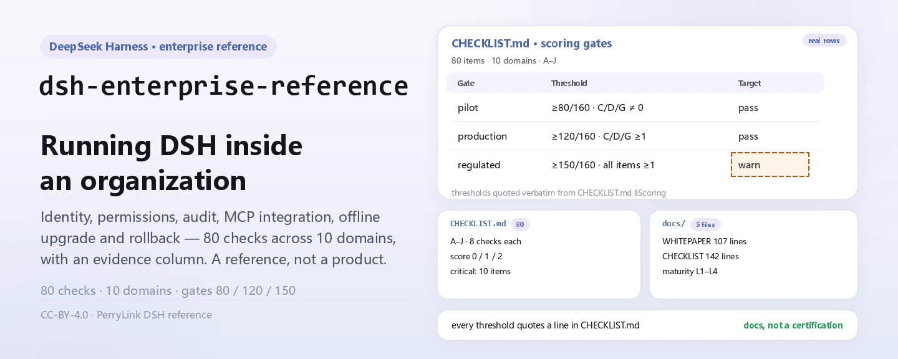
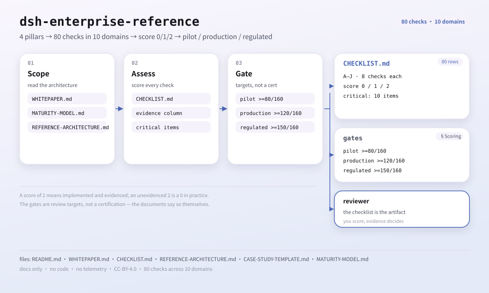
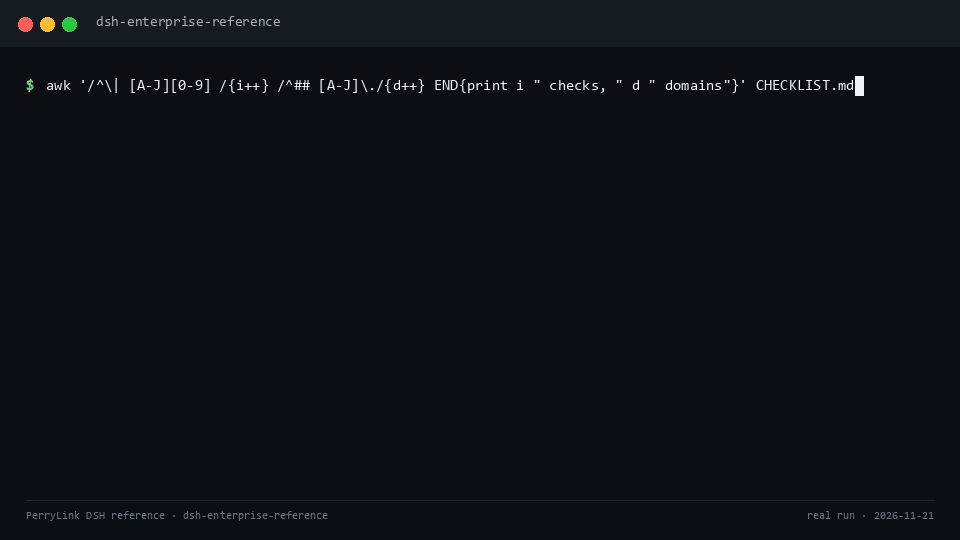

<picture>
  <source media="(prefers-color-scheme: dark)" srcset="docs/assets/dsh-enterprise-reference-hero-en-dark.webp">
  
</picture>

# dsh-enterprise-reference

**Una arquitectura de referencia neutral respecto al proveedor para ejecutar DeepSeek Harness dentro de una organización.**

*Identidad, permisos, auditoría, integración MCP y actualización/rollback offline — como cuatro pilares, una checklist de 80 ítems en 10 dominios, un modelo de madurez L1–L4 y una ruta de piloto de 4 semanas. No es un producto ni una certificación.*

[English](README.md) · [简体中文](README-zh.md) · **Español** · [Português](README-pt.md) · [हिन्दी](README-hi.md)

> Una referencia neutral respecto al proveedor para ejecutar DeepSeek Harness (DSH) dentro de una organización: identidad, permisos, auditoría, integración MCP y actualización/rollback offline.
> **Proyecto comunitario independiente. Sin afiliación con DeepSeek.** Licencia: CC-BY-4.0.

DSH es un agent harness open source que evoluciona rápido. Es excelente para desarrolladores individuales, pero las empresas hacen otras preguntas:

- ¿Quién puede ejecutar qué, sobre qué datos y con qué herramientas?
- ¿Podemos demostrar qué hizo el agente seis meses después?
- ¿Cómo conectamos sistemas internos sin darle al agente las llaves de todo?
- ¿Cómo actualizamos una preview que cambia rápido sin romper 200 plugins?

Este repositorio es una **arquitectura de referencia + checklist de 80 ítems**, no un producto. Úsalo para acotar un piloto, escribir un RFP o revisar a un proveedor.

---

## Contenido

| Archivo | Propósito |
|---|---|
| `WHITEPAPER.md` | arquitectura, cuatro pilares, modelos de despliegue, hoja de ruta de adopción |
| `CHECKLIST.md` | 80 comprobaciones en 10 dominios, con columna de evidencia |
| `docs/REFERENCE-ARCHITECTURE.md` | diagrama mermaid + responsabilidades de cada componente |
| `docs/CASE-STUDY-TEMPLATE.md` | plantilla de una página para el informe del piloto |
| `docs/MATURITY-MODEL.md` | modelo de madurez L1–L4 |

<picture>
  <source media="(prefers-color-scheme: dark)" srcset="docs/assets/dsh-enterprise-reference-flow-v5-dark.svg">
  
</picture>

*Estructura: acotar → evaluar → pasar la puerta; `WHITEPAPER.md` nombra los cuatro pilares, `CHECKLIST.md` lleva las 80 filas y la columna de evidencia, y el bloque `Scoring` convierte la puntuación en una decisión de piloto / producción / regulado. Las etiquetas del diagrama son los nombres reales de archivos, dominios y valores de las puertas, así que la misma imagen sirve a los cinco idiomas.*

## Cómo usarlo

*Animado: una ejecución real sobre los documentos comprometidos el 2026-11-21 — `awk` cuenta las 80 filas y los 10 dominios, y `sed` imprime literalmente el bloque de scoring de `CHECKLIST.md`. Este repositorio es solo documentación, así que los propios documentos son la ejecución.*

1. Ejecuta la checklist como evaluación de brechas; puntúa cada ítem 0/1/2.
2. Elige un modelo de despliegue (equipo único / plataforma de equipo / air-gapped).
3. Haz un piloto de 4 semanas con un flujo de trabajo, una fuente de datos y una integración.
4. Escribe el caso de estudio con la plantilla; no publiques datos de clientes.

## No objetivos

- No es una certificación de seguridad.
- No es un producto ni una hoja de ruta de DeepSeek.
- No es asesoría legal.

## Contribuir

Se agradecen correcciones y experiencia de campo. Abre un issue con el número del ítem de la checklist y la evidencia.

## Semillas relacionadas

- [dsh-hcb](https://github.com/PerryLink/dsh-hcb) 0.12.0 — **136 checked + 7 tested / 3 FLOW `manual` / gate 2 blocked · 31 review · 109 pilot · 1 `production-candidate`**, checker **143/143 rows on `dsh-standards@1.7.0`**: comprueba la compatibilidad de plugins antes de actualizar. Solo `dsh-plugin-guide@0.5.9` es production-candidate; otras 6 filas están probadas (`dsh-budget@0.4.26`, `dsh-defend@0.3.28`, `dsh-mask@0.2.25`, `dsh-memento@0.5.31`, `dsh-observe@0.2.28`, `dsh-test-drive@0.3.26`), no todas.
- [dsh-ecosystem-archive](https://github.com/PerryLink/dsh-ecosystem-archive) — instantáneas fechadas del ecosistema para contexto de compras y tendencias.
