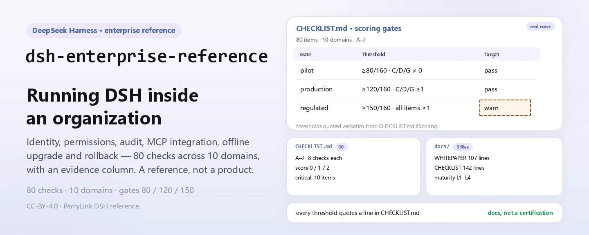
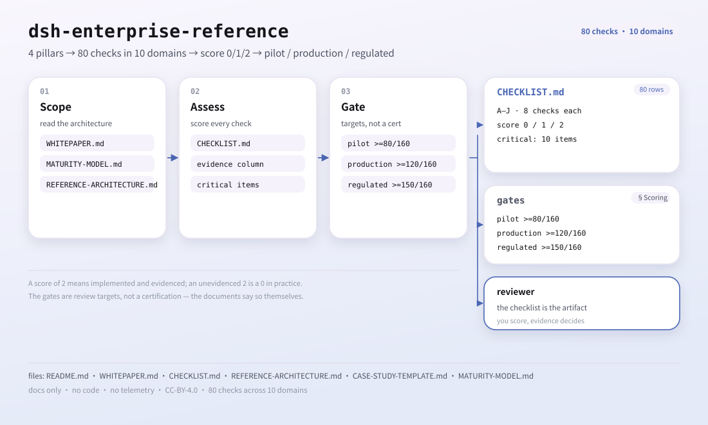
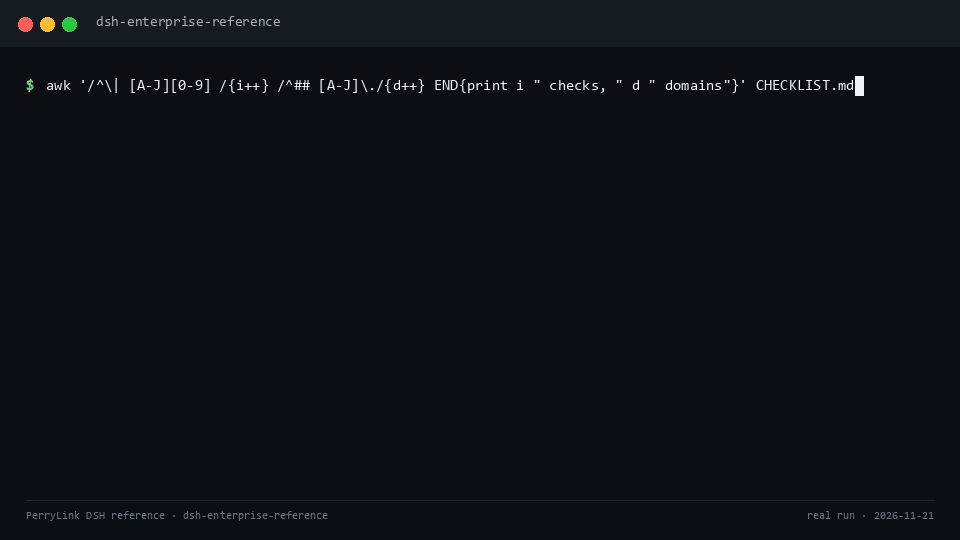

<picture>
  <source media="(prefers-color-scheme: dark)" srcset="docs/assets/dsh-enterprise-reference-hero-en-dark.webp">
  
</picture>

# dsh-enterprise-reference

**किसी संगठन के अंदर DeepSeek Harness चलाने के लिए vendor-तटस्थ संदर्भ आर्किटेक्चर।**

*पहचान, अनुमतियाँ, ऑडिट, MCP एकीकरण, और offline अपग्रेड/रोलबैक — चार स्तंभ, 10 domains में 80-आइटम checklist, L1–L4 maturity model और 4-सप्ताह का pilot मार्ग। यह उत्पाद नहीं, प्रमाणन नहीं।*

[English](README.md) · [简体中文](README-zh.md) · [Español](README-es.md) · [Português](README-pt.md) · **हिन्दी**

> किसी संगठन के अंदर DeepSeek Harness (DSH) चलाने के लिए एक vendor-तटस्थ संदर्भ: पहचान, अनुमतियाँ, ऑडिट, MCP एकीकरण, और offline अपग्रेड/रोलबैक।
> **स्वतंत्र समुदाय परियोजना। DeepSeek से कोई संबद्धता नहीं।** लाइसेंस: CC-BY-4.0।

DSH एक तेज़ी से बदलता open-source agent harness है। यह व्यक्तिगत डेवलपर्स के लिए उत्कृष्ट है, पर उद्यम अलग सवाल पूछते हैं:

- कौन क्या चला सकता है, किस डेटा पर, किन टूल के साथ?
- छह महीने बाद हम साबित कर सकते हैं कि agent ने क्या किया?
- आंतरिक सिस्टम कैसे जोड़ें बिना agent को सबकी चाबियाँ दे?
- तेज़ी से बदलते preview को अपग्रेड कैसे करें बिना 200 प्लगइन तोड़े?

यह रिपॉज़िटरी एक **संदर्भ आर्किटेक्चर + 80-आइटम checklist** है, उत्पाद नहीं। इसका उपयोग pilot का दायरा तय करने, RFP लिखने या किसी vendor की समीक्षा के लिए करें।

---

## सामग्री

| फ़ाइल | उद्देश्य |
|---|---|
| `WHITEPAPER.md` | आर्किटेक्चर, चार स्तंभ, deployment models, adoption roadmap |
| `CHECKLIST.md` | 10 domains में 80 जाँचें, evidence कॉलम के साथ |
| `docs/REFERENCE-ARCHITECTURE.md` | mermaid डायग्राम + घटकों की ज़िम्मेदारियाँ |
| `docs/CASE-STUDY-TEMPLATE.md` | pilot रिपोर्ट के लिए एक-पृष्ठ टेम्पलेट |
| `docs/MATURITY-MODEL.md` | L1–L4 maturity model |

<picture>
  <source media="(prefers-color-scheme: dark)" srcset="docs/assets/dsh-enterprise-reference-flow-v5-dark.svg">
  
</picture>

*संरचना: दायरा → आकलन → गेट; `WHITEPAPER.md` चार स्तंभ बताता है, `CHECKLIST.md` 80 पंक्तियाँ और evidence कॉलम रखता है, और `Scoring` ब्लॉक अंकों को pilot / production / regulated निर्णय में बदलता है। डायग्राम के अंदर केवल असली फ़ाइल नाम, domains और गेट मान हैं, इसलिए एक ही चित्र पाँचों भाषाओं के लिए काम आता है।*

## इसका उपयोग कैसे करें

*एनिमेटेड: 2026-11-21 को commit किए गए दस्तावेज़ों पर एक असली रन — `awk` 80 पंक्तियाँ और 10 domains गिनता है, `sed` `CHECKLIST.md` का scoring ब्लॉक शब्दशः छापता है। यह रिपॉज़िटरी केवल दस्तावेज़ है, इसलिए दस्तावेज़ ही वह रन हैं।*

1. checklist को gap assessment की तरह चलाएँ; हर आइटम को 0/1/2 दें।
2. एक deployment model चुनें (single team / team platform / air-gapped)।
3. एक workflow, एक data source और एक integration के साथ 4-सप्ताह का pilot करें।
4. template से case study लिखें; customer data प्रकाशित न करें।

## गैर-लक्ष्य

- सुरक्षा प्रमाणन नहीं।
- DeepSeek का उत्पाद या roadmap नहीं।
- कानूनी सलाह नहीं।

## योगदान

सुधार और फ़ील्ड अनुभव स्वागत हैं। checklist आइटम संख्या और evidence के साथ issue खोलें।

## संबंधित seeds

- [dsh-hcb](https://github.com/PerryLink/dsh-hcb) 0.12.0 — **136 checked + 7 tested / 3 FLOW `manual` / gate 2 blocked · 31 review · 109 pilot · 1 `production-candidate`**, checker **143/143 rows on `dsh-standards@1.7.0`**: अपग्रेड से पहले plugin compatibility जाँचें। केवल `dsh-plugin-guide@0.5.9` production-candidate है; 6 और पंक्तियाँ tested हैं (`dsh-budget@0.4.26`, `dsh-defend@0.3.28`, `dsh-mask@0.2.25`, `dsh-memento@0.5.31`, `dsh-observe@0.2.28`, `dsh-test-drive@0.3.26`), सभी नहीं।
- [dsh-ecosystem-archive](https://github.com/PerryLink/dsh-ecosystem-archive) — खरीद और रुझान संदर्भ के लिए तिथि-युक्त ecosystem snapshots।
