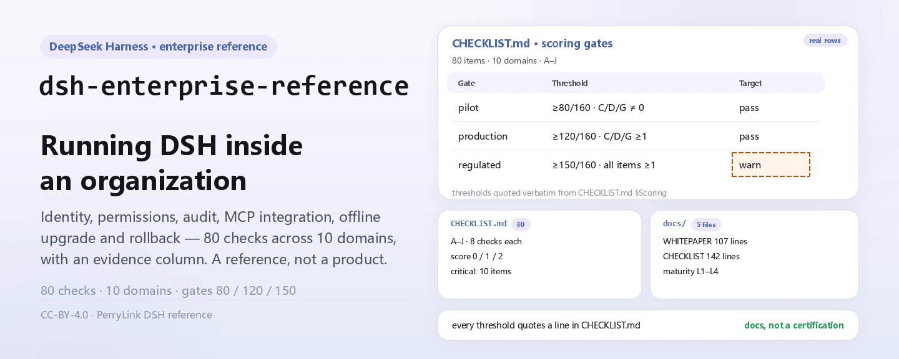
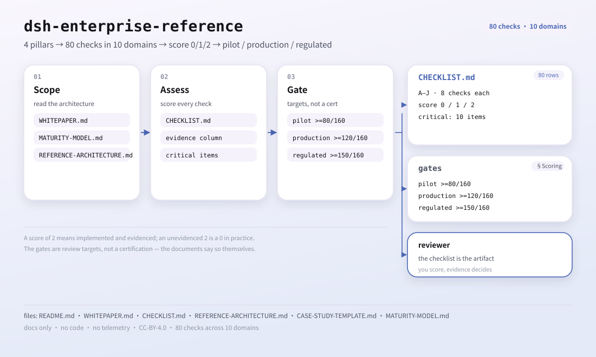
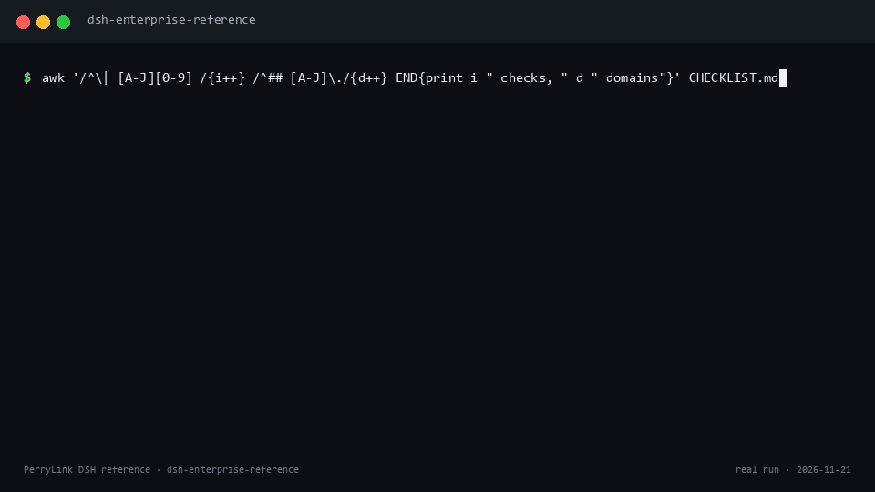

<picture>
  <source media="(prefers-color-scheme: dark)" srcset="docs/assets/dsh-enterprise-reference-hero-en-dark.webp">
  
</picture>

# dsh-enterprise-reference

**Uma arquitetura de referência neutra em relação a fornecedor para executar o DeepSeek Harness dentro de uma organização.**

*Identidade, permissões, auditoria, integração MCP e atualização/rollback offline — como quatro pilares, uma checklist de 80 itens em 10 domínios, um modelo de maturidade L1–L4 e um caminho de piloto de 4 semanas. Não é um produto nem uma certificação.*

[English](README.md) · [简体中文](README-zh.md) · [Español](README-es.md) · **Português** · [हिन्दी](README-hi.md)

> Uma referência neutra em relação a fornecedor para executar o DeepSeek Harness (DSH) dentro de uma organização: identidade, permissões, auditoria, integração MCP e atualização/rollback offline.
> **Projeto comunitário independente. Sem afiliação com a DeepSeek.** Licença: CC-BY-4.0.

O DSH é um agent harness open source que evolui rápido. É excelente para desenvolvedores individuais, mas as empresas fazem outras perguntas:

- Quem pode executar o quê, sobre quais dados e com quais ferramentas?
- Conseguimos provar o que o agente fez seis meses depois?
- Como conectamos sistemas internos sem entregar ao agente as chaves de tudo?
- Como atualizamos uma preview que muda rápido sem quebrar 200 plugins?

Este repositório é uma **arquitetura de referência + checklist de 80 itens**, não um produto. Use para delimitar um piloto, escrever um RFP ou avaliar um fornecedor.

---

## Conteúdo

| Arquivo | Propósito |
|---|---|
| `WHITEPAPER.md` | arquitetura, quatro pilares, modelos de implantação, roteiro de adoção |
| `CHECKLIST.md` | 80 verificações em 10 domínios, com coluna de evidência |
| `docs/REFERENCE-ARCHITECTURE.md` | diagrama mermaid + responsabilidades de cada componente |
| `docs/CASE-STUDY-TEMPLATE.md` | modelo de uma página para o relato do piloto |
| `docs/MATURITY-MODEL.md` | modelo de maturidade L1–L4 |

<picture>
  <source media="(prefers-color-scheme: dark)" srcset="docs/assets/dsh-enterprise-reference-flow-v5-dark.svg">
  
</picture>

*Estrutura: delimitar → avaliar → passar o portão; `WHITEPAPER.md` nomeia os quatro pilares, `CHECKLIST.md` carrega as 80 linhas e a coluna de evidência, e o bloco `Scoring` transforma a pontuação numa decisão de piloto / produção / regulado. Os rótulos do diagrama são os nomes reais de arquivos, domínios e valores dos portões, então a mesma imagem serve aos cinco idiomas.*

## Como usar

*Animado: uma execução real sobre os documentos commitados em 2026-11-21 — `awk` conta as 80 linhas e os 10 domínios, e `sed` imprime literalmente o bloco de scoring do `CHECKLIST.md`. Este repositório é só documentação, então os próprios documentos são a execução.*

1. Rode a checklist como avaliação de lacunas; pontue cada item 0/1/2.
2. Escolha um modelo de implantação (equipe única / plataforma de equipe / air-gapped).
3. Faça um piloto de 4 semanas com um fluxo de trabalho, uma fonte de dados e uma integração.
4. Escreva o estudo de caso com o modelo; não publique dados de clientes.

## Não objetivos

- Não é uma certificação de segurança.
- Não é um produto nem um roteiro da DeepSeek.
- Não é aconselhamento jurídico.

## Contribuindo

Correções e experiência de campo são bem-vindas. Abra uma issue com o número do item da checklist e a evidência.

## Sementes relacionadas

- [dsh-hcb](https://github.com/PerryLink/dsh-hcb) 0.12.0 — **136 checked + 7 tested / 3 FLOW `manual` / gate 2 blocked · 31 review · 109 pilot · 1 `production-candidate`**, checker **143/143 rows on `dsh-standards@1.7.0`**: verifique a compatibilidade de plugins antes de atualizar. Só `dsh-plugin-guide@0.5.9` é production-candidate; outras 6 linhas estão testadas (`dsh-budget@0.4.26`, `dsh-defend@0.3.28`, `dsh-mask@0.2.25`, `dsh-memento@0.5.31`, `dsh-observe@0.2.28`, `dsh-test-drive@0.3.26`), não todas.
- [dsh-ecosystem-archive](https://github.com/PerryLink/dsh-ecosystem-archive) — instantâneos datados do ecossistema para contexto de compras e tendências.
