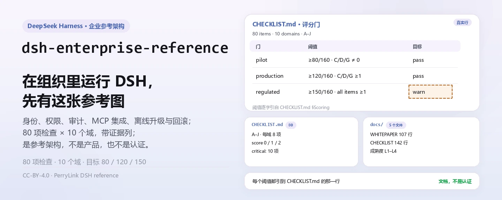
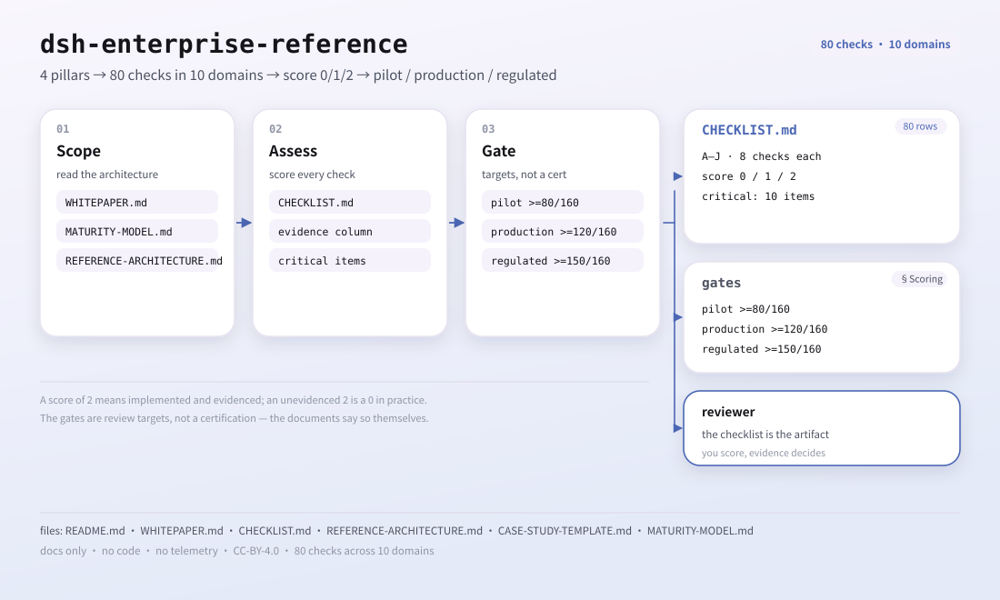
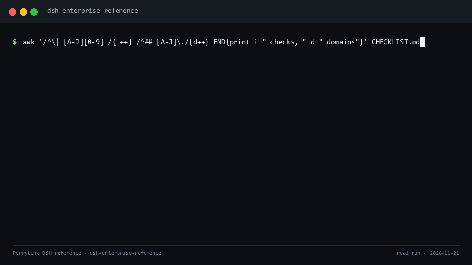

<picture>
  <source media="(prefers-color-scheme: dark)" srcset="docs/assets/dsh-enterprise-reference-hero-zh-dark.webp">
  
</picture>

# dsh-enterprise-reference

**一份厂商中立的参考架构：如何在组织内部运行 DeepSeek Harness。**

*身份、权限、审计、MCP 集成、离线升级与回滚 —— 落成四大支柱、跨 10 个域的 80 项检查、L1–L4 成熟度模型和一条 4 周试点路径。不是产品，也不是认证。*

[English](README.md) · **简体中文** · [Español](README-es.md) · [Português](README-pt.md) · [हिन्दी](README-hi.md)

> 一份厂商中立的参考，讲如何在组织内部运行 DeepSeek Harness（DSH）：身份、权限、审计、MCP 集成，以及离线升级与回滚。
> **独立社区项目，与 DeepSeek 无隶属关系。** 许可：CC-BY-4.0。

DSH 是一个快速演进的开源 agent harness。它对个人开发者很友好，但企业会问另外一些问题：

- 谁能运行什么、在哪些数据上、能用哪些工具？
- 六个月后，我们能不能证明 agent 做过什么？
- 怎么接入内部系统，又不至于把全部钥匙都交给 agent？
- 怎么升级一个快速变化的预览版，而不弄坏 200 个插件？

本仓库是**参考架构 + 80 项检查清单**，不是产品。可以用它圈定试点范围、写 RFP，或评审供应商。

---

## 内容

| 文件 | 用途 |
|---|---|
| `WHITEPAPER.md` | 架构、四大支柱、部署模型、采用路线图 |
| `CHECKLIST.md` | 跨 10 个域的 80 项检查，带证据列 |
| `docs/REFERENCE-ARCHITECTURE.md` | mermaid 图 + 组件职责 |
| `docs/CASE-STUDY-TEMPLATE.md` | 一页纸的试点总结模板 |
| `docs/MATURITY-MODEL.md` | L1–L4 成熟度模型 |

<picture>
  <source media="(prefers-color-scheme: dark)" srcset="docs/assets/dsh-enterprise-reference-flow-v5-dark.svg">
  
</picture>

*结构：圈定 → 评估 → 过门；`WHITEPAPER.md` 给出四大支柱，`CHECKLIST.md` 承载 80 行检查与证据列，`Scoring` 一节把得分变成试点 / 生产 / 受监管的决定。图内只有真实的文件名、检查域与阈值，五语共用同一张结构图。*

## 怎么使用

*动图是 2026-11-21 对已提交文档的真实运行 —— `awk` 数出 80 行检查与 10 个域，`sed` 逐字打印 `CHECKLIST.md` 的评分门。本仓库只有文档，所以这些文档本身就是那次运行。*

1. 把清单当作差距评估来跑；每项打 0/1/2。
2. 选一种部署模型（单团队 / 团队平台 / 气隙隔离）。
3. 用一个工作流、一个数据源、一个集成，做 4 周试点。
4. 用模板写案例总结；不要发布客户数据。

## 非目标

- 不是安全认证。
- 不是 DeepSeek 的产品或路线图。
- 不是法律意见。

## 贡献

欢迎纠错与一线经验。请带上清单项编号与证据开 issue。

## 相关种子

- [dsh-hcb](https://github.com/PerryLink/dsh-hcb) 0.12.0 —— **136 checked + 7 tested / 3 FLOW `manual` / gate 2 blocked · 31 review · 109 pilot · 1 `production-candidate`**，checker 在 `dsh-standards@1.7.0` 上 **143/143 rows**：升级前先检查插件兼容性。只有 `dsh-plugin-guide@0.5.9` 是 production-candidate；另有 6 行是已测试（`dsh-budget@0.4.26`、`dsh-defend@0.3.28`、`dsh-mask@0.2.25`、`dsh-memento@0.5.31`、`dsh-observe@0.2.28`、`dsh-test-drive@0.3.26`），并非全部行。
- [dsh-ecosystem-archive](https://github.com/PerryLink/dsh-ecosystem-archive) —— 带日期的生态快照，供采购与趋势判断参考。
