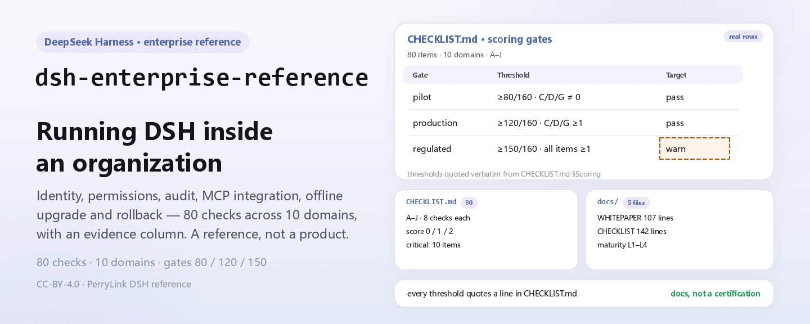
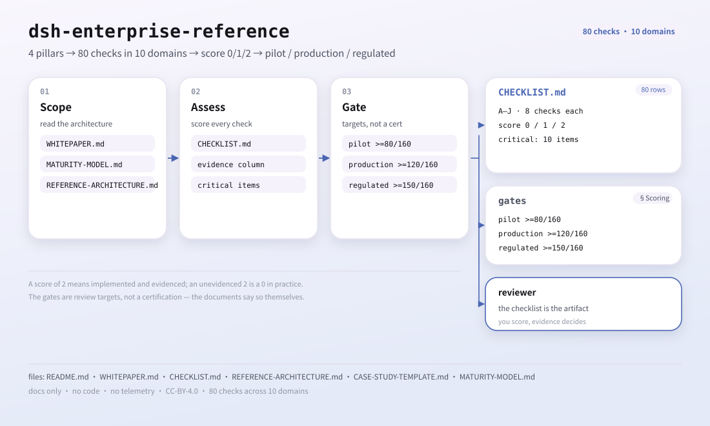
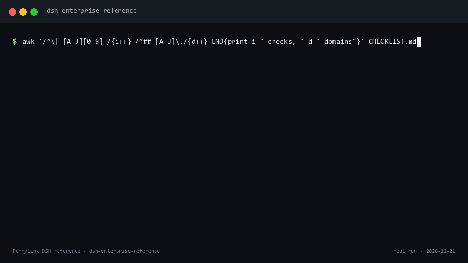

<picture>
  <source media="(prefers-color-scheme: dark)" srcset="docs/assets/dsh-enterprise-reference-hero-en-dark.webp">
  
</picture>

# dsh-enterprise-reference

**A vendor-neutral reference architecture for running DeepSeek Harness inside an organization.**

*Identity, permissions, audit, MCP integration, and offline upgrade/rollback — as four pillars, an 80-item checklist across 10 domains, an L1–L4 maturity model and a 4-week pilot path. Not a product, not a certification.*

[简体中文](README-zh.md) · [Español](README-es.md) · [Português](README-pt.md) · [हिन्दी](README-hi.md)

> A vendor-neutral reference for running DeepSeek Harness (DSH) inside an organization: identity, permissions, audit, MCP integration, and offline upgrade/rollback.
> **Independent community project. Not affiliated with DeepSeek.** License: CC-BY-4.0.

DSH is a fast-moving open-source agent harness. It is excellent for individual developers, but enterprises ask different questions:

- Who can run what, on which data, with which tools?
- Can we prove what the agent did six months later?
- How do we connect internal systems without giving the agent the keys to everything?
- How do we upgrade a fast-moving preview without breaking 200 plugins?

This repository is a **reference architecture + 80-item checklist**, not a product. Use it to scope a pilot, write an RFP, or review a vendor.

---

## Contents

| File | Purpose |
|---|---|
| `WHITEPAPER.md` | architecture, four pillars, deployment models, adoption roadmap |
| `CHECKLIST.md` | 80 checks across 10 domains, with evidence column |
| `docs/REFERENCE-ARCHITECTURE.md` | mermaid diagram + component responsibilities |
| `docs/CASE-STUDY-TEMPLATE.md` | one-page template for a pilot write-up |
| `docs/MATURITY-MODEL.md` | L1–L4 maturity model |

<picture>
  <source media="(prefers-color-scheme: dark)" srcset="docs/assets/dsh-enterprise-reference-flow-v5-dark.svg">
  
</picture>

*Structure: scope → assess → gate; `WHITEPAPER.md` names the four pillars, `CHECKLIST.md` carries the 80 rows and an evidence column, and the `Scoring` block turns the score into a pilot / production / regulated decision. The token labels inside the diagram are the real file names, check domains and gate values, so the same picture serves all five languages.*

## How to use

*Animated: a real run over the committed documents on 2026-11-21 — `awk` counts the 80 rows and 10 domains, then `sed` prints the scoring block from `CHECKLIST.md` verbatim. This repository is documentation only, so the documents themselves are the run.*

1. Run the checklist as a gap assessment; score each item 0/1/2.
2. Pick one deployment model (single team / team platform / air-gapped).
3. Do a 4-week pilot with one workflow, one data source, and one integration.
4. Write the case study with the template; do not publish customer data.

## Non-goals

- Not a security certification.
- Not a DeepSeek product or roadmap.
- Not legal advice.

## Contributing

Corrections and field experience are welcome. Please open an issue with the checklist item number and evidence.

## Related seeds

- [dsh-hcb](https://github.com/PerryLink/dsh-hcb) 0.12.0 — **136 checked + 7 tested / 3 FLOW `manual` / gate 2 blocked · 31 review · 109 pilot · 1 `production-candidate`**, checker **143/143 rows on `dsh-standards@1.7.0`**: check plugin compatibility before upgrades. Only `dsh-plugin-guide@0.5.9` is the production-candidate; 6 further rows are tested (`dsh-budget@0.4.26`, `dsh-defend@0.3.28`, `dsh-mask@0.2.25`, `dsh-memento@0.5.31`, `dsh-observe@0.2.28`, `dsh-test-drive@0.3.26`), not all rows.
- [dsh-ecosystem-archive](https://github.com/PerryLink/dsh-ecosystem-archive) — dated ecosystem snapshots for procurement/trend context.
