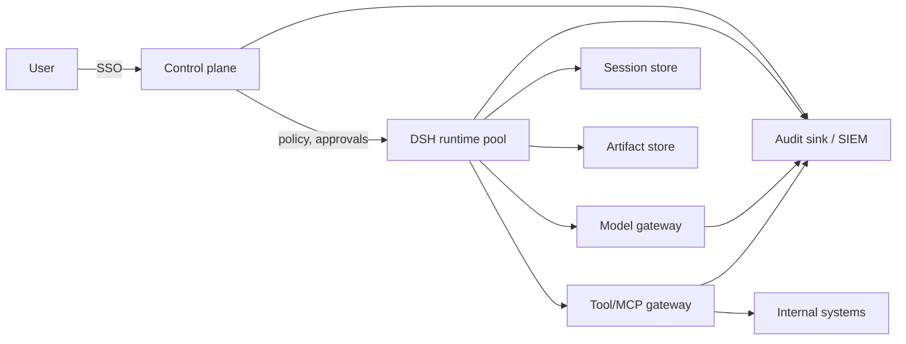

# Reference architecture (diagram)

## Responsibilities

| Component | Owns | Does not own |
|---|---|---|
| Control plane | identity, RBAC, policy, plugin allowlist, version pinning | prompt content |
| Runtime | agent loop, tools, sandbox | long-term retention |
| Model gateway | provider routing, quotas, logging | user identity |
| Tool/MCP gateway | credentials, rate limits, kill switch | model choice |
| Audit sink | immutability, retention, export | policy decisions |
